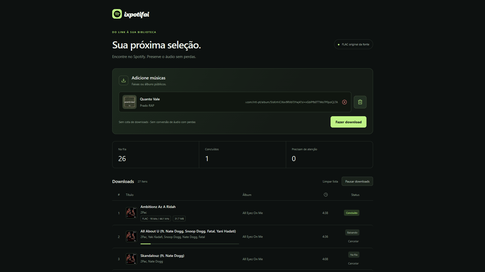

# ixpotifai

Aplicativo local gratuito para obter arquivos FLAC a partir de músicas escolhidas no Spotify. Executa no seu próprio computador, com uma interface aberta no navegador. Primeira versão funcional: 14/10/2026.

Versão **0.1.2**: verificação automática de novas versões, aviso com opção de adiar, atualização pelo aplicativo e reinício com recuperação em caso de falha. Inclui as correções de downloads e usabilidade da versão 0.1.1.

## Preview



*Captura da interface com músicas adicionadas à fila de downloads.*

## Baixar o projeto

1. [Baixe o ixpotifai em ZIP](https://github.com/gpradotech/ixpotifai/archive/refs/heads/main.zip), ou abra [o repositório](https://github.com/gpradotech/ixpotifai) e escolha **Code → Download ZIP**.
2. Extraia **todo o ZIP** para uma pasta do computador, como `Documentos/ixpotifai`. Não execute o aplicativo de dentro do ZIP.
3. Instale [Node.js 22.19 ou superior](https://nodejs.org/), que inclui o npm. Depois da instalação, feche e abra novamente o terminal, se estiver usando um.

Você precisa de conexão com a internet para a primeira instalação, para reconhecer os links e para baixar músicas. Não precisa instalar Git para usar o ZIP, criar conta no ixpotifai ou configurar credenciais do Spotify.

O GitHub distribui o código do projeto. Abrir o link do repositório não executa a aplicação: siga a instalação abaixo no computador que receberá os arquivos de áudio.

## Instalar e abrir

### Windows

1. Abra a pasta extraída e dê dois cliques em **`Iniciar ixpotifai.cmd`**.
2. Na primeira execução, aguarde a instalação das dependências e do FFmpeg. Nas seguintes, o aplicativo abre diretamente.
3. O navegador será aberto em **http://127.0.0.1:4317**. Se não abrir automaticamente, acesse esse endereço manualmente.
4. Mantenha a janela do terminal aberta durante o uso. Para encerrar, pressione **Ctrl+C** nessa janela.

Se preferir iniciar pelo terminal, abra o PowerShell na pasta extraída e execute:

```powershell
$env:NODE_OPTIONS='--use-system-ca'
npm.cmd ci --no-audit --no-fund --cache .ixpotifai/npm-cache
npm.cmd start
```

### macOS

1. Abra o Terminal e entre na pasta extraída. Você pode digitar `cd `, arrastar a pasta para o Terminal e pressionar Enter.
2. Execute:

```sh
chmod +x start.command
./start.command
```

O script instala as dependências na primeira execução, inicia o servidor local e abre o navegador. Mantenha o Terminal aberto; encerre com **Ctrl+C**.

Alternativa, sem usar o script de abertura:

```sh
NODE_OPTIONS=--use-system-ca npm ci --no-audit --no-fund --cache .ixpotifai/npm-cache
npm start
```

A instalação baixa o FFmpeg para o sistema do computador. Se transferir o projeto entre Windows e macOS, copie o código e instale novamente as dependências; não copie a pasta `node_modules`. O Windows foi testado; a execução em macOS ainda precisa de validação em um Mac.

## Atualizar uma instalação existente

A partir da versão **0.1.2**, o aplicativo verifica novas versões ao abrir e a cada seis horas enquanto estiver em execução. Quando há uma versão estável nova, mostra um aviso com as melhorias e os botões **Atualizar e reiniciar** e **Mais tarde**. Ao adiar, o aviso passa a ser uma indicação discreta, sem reabrir a cada consulta ou recarregamento. O rodapé também permite verificar atualizações manualmente.

Ao confirmar, o aplicativo baixa e confere o pacote oficial. Se houver downloads ativos, oferece **Atualizar ao terminar os downloads**. A preparação pode ser cancelada antes de a instalação começar. A instalação preserva áudios, lista, pasta escolhida e configurações; prepara dependências novas quando necessário e reinicia o servidor. A página reconecta automaticamente. Se a nova versão não iniciar, o launcher restaura a versão anterior e o estado da fila. A instalação deve ser aberta pelo launcher ou por `npm start` para permitir esse reinício. Cópias de desenvolvimento com `.git` são atualizadas pelo Git, preservando o trabalho local.

**Quem usa 0.1.0 ou 0.1.1 precisa fazer a atualização manual abaixo uma última vez para receber o atualizador.** Depois disso, novas versões publicadas como GitHub Releases com pacote de atualização poderão ser instaladas pelo próprio aplicativo.

Para essa primeira atualização, ou para atualizar manualmente:

1. Encerre o aplicativo com **Ctrl+C** no terminal.
2. Baixe o [ZIP atualizado](https://github.com/gpradotech/ixpotifai/archive/refs/heads/main.zip) e extraia em uma pasta temporária.
3. Copie o conteúdo da pasta extraída para a pasta da instalação existente, aceitando substituir os arquivos do aplicativo. Não copie apenas a pasta externa criada pelo ZIP.
4. Preserve as pastas `.ixpotifai` (lista e configurações), `downloads` (áudios) e `node_modules` (dependências). Elas não fazem parte do ZIP e não devem ser apagadas. Áudios salvos em outro destino permanecem onde estão.
5. Abra novamente pelo launcher e atualize o navegador com **Ctrl+F5**.

Na atualização de 0.1.0/0.1.1 para 0.1.2, as dependências não mudaram; não é necessário reinstalar o Node.js nem executar a instalação novamente. Extrair em outra pasta e abrir essa nova cópia sem transferir o histórico cria uma instalação separada. Atualizar apenas a página do navegador não atualiza o servidor que já está em execução.

A execução e a recuperação do atualizador foram testadas no Windows; a execução em um Mac continua pendente. Consulte o [funcionamento técnico e o processo de publicação](docs/ATUALIZACOES.md).

## Primeiro download

1. No Spotify, copie o link de uma faixa, álbum ou playlist pública.
2. Cole o link no campo **Adicione músicas**. Ao reconhecer o link, o aplicativo mostra capa, título e autores, e cria o próximo campo automaticamente.
3. Você pode preencher até **cinco links por envio**. Não há cota diária nem limite total de músicas imposto pelo aplicativo.
4. Se desejar, clique na pasta de saída no rodapé, navegue até outra pasta e confirme em **Usar esta pasta**. O destino inicial é `downloads`, dentro da pasta do projeto.
5. Clique em **Fazer download**. Os metadados das adições aparecem primeiro; depois, os downloads são executados um por vez. Adicionar novas músicas retoma automaticamente os downloads pausados.
6. Aguarde **Concluído**. Apenas o áudio estará na pasta escolhida, com nome `Artistas - Título.flac`. Os dados técnicos da validação ficam no histórico interno do aplicativo, em `.ixpotifai/state.json`.

**Pausar downloads** interrompe a transferência em andamento e preserva a fila para retomar. **Limpar lista** remove os itens da interface, preserva os arquivos e oferece a opção de desfazer. Ao reiniciar o aplicativo, a fila e a pasta escolhida são recuperadas; use **Retomar downloads** para continuar pedidos pendentes.

O botão **Fazer download** fica desabilitado com o formulário vazio ou inválido. Para reproduzir um arquivo concluído, passe o ponteiro pela linha da música e clique em Play. O arquivo é salvo automaticamente pelo aplicativo local; não há uma segunda etapa de salvar pelo navegador.

## Se algo não funcionar

| Situação | O que fazer |
| --- | --- |
| Node.js ou npm não encontrado | Instale o Node.js, reabra o terminal e tente novamente. Confira a versão com `node --version`. |
| A instalação não terminou | Execute novamente o launcher ou `npm ci` pelo terminal; a primeira instalação precisa de internet. |
| A página não abre | Confirme que o terminal continua aberto e acesse `http://127.0.0.1:4317`. Se já houver uma instância aberta, use a janela existente. |
| O botão Fazer download está desabilitado | Preencha um link válido do Spotify e corrija campos preenchidos inválidos. Um campo vazio adicional ao final é permitido. |
| A música já existe na pasta | O aplicativo não sobrescreve arquivos. Confira a pasta de saída ou escolha outro destino. |
| A pasta escolhida não pode ser acessada | Escolha uma pasta na qual sua conta tenha permissão de escrita; execute o aplicativo normalmente pelo launcher. |
| Uma faixa não tem versão compatível | Tente novamente mais tarde. A disponibilidade depende da fonte e da identificação da gravação; não há cobertura garantida de todo o catálogo. |
| A playlist não pode ser importada integralmente | Confira se ela é pública; quando a lista completa não está disponível, use os links individuais. |

## Controles e funcionamento

Acesse **http://127.0.0.1:4317**. Cole um link por campo. O próximo campo aparece automaticamente quando o link é reconhecido, até cinco campos por envio. Fazer download fica desabilitado enquanto o formulário estiver vazio ou inválido e durante a preparação. Ao reconhecer o link, cada campo mostra capa, título e artista, mantendo o endereço editável. No desktop, o link fica em uma terceira coluna e pode ser truncado; no mobile, a prévia mostra capa, título e artista. O XCircle vermelho limpa o campo e devolve o foco para digitação. Campos intermediários vazios desaparecem ao perder o foco. O Trash verde exclui o campo e fica vermelho no hover; sempre resta pelo menos um campo para digitar. Links repetidos entre campos ou já presentes na lista são recusados, inclusive com parâmetros de compartilhamento diferentes.

Clique em **Fazer download**. O aplicativo prepara os metadados de todas as adições, mostra as capas, títulos e artistas na lista e só então inicia as transferências, uma por vez. Se os downloads estavam pausados, adicionar novas músicas os retoma automaticamente.

O rodapé mostra o caminho completo da **pasta de saída**, inicialmente `downloads/` dentro do projeto. Clique nesse caminho para abrir o navegador de pastas dentro do aplicativo. Navegue pelas subpastas ou use Pasta anterior. **Carregar pasta** atualiza a lista do modal com o caminho digitado. **Voltar à raiz** retorna à pasta `downloads/` original do projeto, mesmo que outro destino tenha sido configurado. Confirme o destino em Usar esta pasta. Abrir o explorador ou navegar no modal não altera o destino até essa confirmação. A escolha é preservada ao reiniciar e vale para os próximos downloads; arquivos anteriores permanecem onde foram salvos. A troca de pasta fica indisponível durante a preparação ou uma transferência ativa. Cancelar o seletor mantém o destino atual.

O processo precisa ter permissão de acesso à pasta escolhida. O launcher `Iniciar ixpotifai.cmd`, aberto normalmente pelo usuário, executa o aplicativo com as permissões da própria conta do Windows. O seletor navega pelas pastas dentro da interface do aplicativo; não abre o Windows Explorer ou o Finder.

Novos downloads usam o nome `Artistas - Título.flac`, sem o identificador Spotify no nome e sem gerar JSON na pasta de saída. O identificador e a validação permanecem no histórico interno. Arquivos de mesmo nome não são sobrescritos. Os arquivos baixados anteriormente, inclusive relatórios antigos, são preservados. As mensagens gerais e dos campos possuem um botão Phosphor X para fechar. Os alertas dentro das faixas exibem apenas o texto, sem botão X; o botão de remover a faixa permanece independente.

A seção Downloads exibe dez músicas por página, com navegação para as demais. Limpar lista preserva os arquivos baixados e permite desfazer a última limpeza. O feedback de desfazer aparece somente logo após a limpeza e desaparece ao adicionar uma música ou recarregar a página. O controle global mostra **Pausar downloads** enquanto a fila está em execução e **Retomar downloads** quando está pausada; a retomada pelo botão também recoloca todas as faixas com erro na fila. Quando restam apenas falhas, mostra **Tentar novamente** e tenta todas elas com um clique, inclusive em outras páginas. Faixas concluídas e canceladas são preservadas. A solicitação é confirmada junto à lista e a página da primeira faixa envolvida é exibida; a confirmação não significa que o download já terminou. Sem trabalho pendente nem falhas, o controle fica desabilitado. Com apenas uma música na lista, os rótulos Pausar/Retomar usam download no singular. Ao adicionar novas músicas, os downloads pausados são retomados automaticamente depois que os metadados das adições são renderizados. O botão de limpar aparece somente nos campos preenchidos. Para encerrar, pressione Ctrl+C no terminal do aplicativo.

Quando um serviço responde **HTTP 429**, ele está limitando pedidos. O aplicativo interrompe o avanço da fila, mostra **Aguardando a fonte** com contagem regressiva e respeita o cabeçalho `Retry-After`. A espera é de pelo menos 60 segundos, aumentando para 120 e 240 segundos se o limite persistir; um prazo maior informado pelo serviço prevalece. Há até três novas tentativas automáticas para essa condição. Se todas falharem, a faixa volta a Precisa de atenção e a fila é pausada, sem disparar pedidos para as próximas músicas. Outros erros não entram nesse ciclo automático. Pausar, cancelar, remover ou encerrar interrompe a espera; retomada e reinício preservam o prazo pendente. Isso reduz pedidos repetidos, mas não garante disponibilidade da fonte.

Alterações no servidor exigem encerrar o aplicativo com **Ctrl+C**, reabrir pelo launcher e atualizar a página. Atualizar apenas o navegador carrega o JavaScript novo, mas mantém o servidor antigo em memória. A interface detecta essa incompatibilidade nas novas tentativas e orienta a reiniciar, em vez de enviar um comando não suportado. Mensagens de ações da lista aparecem na própria seção Downloads, separadas dos avisos da adição de links.

O cabeçalho da lista permite ordenar por ordem de adição, título/artista, álbum, duração e status. Número e duração alternam crescente, decrescente e desligado; álbum e status alternam A–Z, Z–A e desligado. Título possui cinco estados: título A–Z, título Z–A, artista A–Z, artista Z–A e desligado. A ordenação vale para a lista inteira antes da paginação e retorna à primeira página a cada troca. O número exibido sempre acompanha a posição da música na lista atual: 1–10 na primeira página, 11–20 na segunda, e assim por diante, com ou sem ordenação ativa. Exclusões e limpeza não deixam lacunas nem acumulam a contagem de listas anteriores. Ao desativar a ordenação, a lista volta à ordem de adição, da primeira para a última, acompanhando a execução dos downloads. Dados ausentes ficam no final nas duas direções.

BPM e tom não são fornecidos pelos metadados públicos usados pelo conector atual. O Spotify restringiu Audio Features para novas aplicações e aplicações em modo de desenvolvimento afetadas pela [mudança de acesso de novembro de 2024](https://developer.spotify.com/blog/2024-11-27-changes-to-the-web-api). Essas colunas não são exibidas enquanto não houver uma importação disponível; nenhum valor é estimado ou preenchido artificialmente.

As linhas de Downloads mostram número, capa, título, autores, álbum e duração. A numeração continua entre páginas. O contador ao lado do título aparece quando há itens; o estado vazio não tem texto auxiliar nesse cabeçalho. O hover realça suavemente a linha e revela o botão X para removê-la da lista, preservando o arquivo. Remover uma transferência ativa interrompe essa faixa.

Faixas concluídas com arquivo FLAC disponível podem ser reproduzidas pelo navegador, diretamente do arquivo salvo, sem conversão. A ordem de adição continua salva após reiniciar o aplicativo; quando não há ordenação ativa, as músicas aparecem da primeira adicionada para a última, numeradas pela posição atual. No hover, o número dá lugar a Play ou Pause na variante Fill; durante a reprodução, fora do hover, aparece um indicador animado. Após um clique de mouse em Play ou Pause, o realce é encerrado; ele volta quando o ponteiro sai e entra novamente na faixa. Uma faixa toca por vez. Remover a faixa em reprodução ou limpar a lista interrompe o player. Há controles equivalentes para foco pelo teclado e telas sem hover. O player exige sessão local e transmite somente os arquivos associados aos itens concluídos da fila; não aceita um caminho arbitrário na URL.

## Implementado

- Referências públicas do Spotify, correlação entre serviços por Songlink e ISRC.
- Download efetivo por uma fonte não oficial: `tracks.monochrome.st`. Não usa YouTube como áudio de substituição.
- Conferência dos cabeçalhos de todos os arquivos compatíveis retornados pela fonte, escolhendo uma resolução que domine as demais em bits e taxa de amostragem.
- Preservação dos bytes do FLAC recebido. Nenhuma normalização, reamostragem ou conversão de áudio com perdas.
- Validação da duração, resolução, decodificação integral, número real de amostras, MD5 do PCM quando disponível e SHA-256 do arquivo.
- Fila persistente, pausa, retomada, cancelamento, nova tentativa e deduplicação. Erros são apresentados com mensagens amigáveis, sem códigos técnicos ou caminhos de arquivos. Sem cotas por dia, evento ou biblioteca; uma transferência por vez.
- Importação de álbuns públicos e playlists cuja lista completa possa ser confirmada pelos metadados públicos do Spotify. O total informado na página é comparado com as faixas recebidas; listas parciais ou divergentes são recusadas. As capas e os autores faltantes são completados antes de iniciar a fila, com até quatro consultas simultâneas. Playlists maiores que o conteúdo público disponível ainda precisam de um conector paginado.
- Conector compatível com hifi-api para FLAC aberto, incluindo segmentos sem criptografia; instâncias públicas dessa família não comprovaram disponibilidade neste ambiente e não são o padrão.

## Resultado real e limites

A faixa fornecida pelo usuário, **In Da Club — 50 Cent**, foi baixada em FLAC estéreo, **16 bits / 44.100 Hz**, **193,466667 segundos**, **20.968.971 bytes**. O ISRC correlacionado é `USIR10300033`. A decodificação produziu 8.531.880 amostras por canal, e seu MD5 coincide com o STREAMINFO do arquivo. Uma segunda execução ponta a ponta verificou o código revisado. Consulte [a evidência executável](docs/VERIFICACAO-LIVE.json).

**Isso comprova a obtenção e a integridade de um arquivo FLAC, não a identidade do master do Spotify nem a ausência de uma etapa com perdas anterior à publicação nessa fonte.** A pendência de equivalência do master fica registrada no histórico interno de cada download. A maior resolução é comparada dentro dos resultados compatíveis desta fonte; a maior qualidade existente em todos os serviços não foi comprovada. A exigência completa do produto continua pendente, e este protótipo não é uma declaração de sucesso de todos os requisitos.

O arquivo enviado pelo distribuidor, o áudio de reprodução do Spotify e o arquivo entregue pela fonte externa são coisas distintas. O Spotify [aceita WAV e informa convertê-lo para FLAC sem perdas antes da reprodução](https://support.spotify.com/us/artists/article/audio-file-formats/). O ixpotifai preserva o FLAC recebido da fonte externa; não recupera nem identifica o formato do upload original do distribuidor. Gerar WAV a partir desse FLAC não recuperaria o arquivo original. Consulte a [investigação de Imprevisto e os limites dessa verificação](docs/FORMATOS-IMPREVISTO.md).

O Windows foi executado e testado. O código e o launcher atendem às APIs do macOS, mas não houve execução num Mac nesta sessão. Não há instalador nativo assinado nesta versão. O estado “Baixando” representa a transferência real para a pasta escolhida no computador que executa o aplicativo. O downloader produz FLAC; o validador também aceita WAV PCM. Exportar WAV não está implementado.

A disponibilidade depende da fonte, da correlação e da faixa. Não há promessa de baixar qualquer música. Uma falha não gera um arquivo marcado como concluído, e versões divergentes não são substituídas automaticamente.

Em 14/10/2026, **Mente Barulhenta — Mc IG, Mc Lele JP, DJ Oreia e DJ Noiskita** foi identificada com ISRC `BRWMB2600273` e correspondência Tidal `508960012`. As buscas por título, autores e ISRC na fonte atual não retornaram essa gravação. A busca agora tenta também o artista principal e o título isolado, preservando a exigência de ISRC, duração e qualidade. Isso melhora a cobertura, mas não supre uma faixa ausente do catálogo da fonte. A playlist pública **Funk Hits** (`4yDuj9hCcab4Rf9Rlzd6rh`) teve suas 50 faixas importadas com capa, título e autores durante a validação; isso comprova a leitura completa dos metadados, não o download de todas as faixas.

## Privacidade

O servidor escuta somente em `127.0.0.1`, sem telemetria ou conta no aplicativo. Alterações da fila exigem uma sessão local; origem externa e Host inesperado são recusados. Fontes precisam usar HTTPS público com TLS verificado; DNS validado é fixado à conexão e endereços privados são rejeitados, inclusive em redirecionamentos.

Pedidos de metadados e arquivos contatam Spotify, Songlink, Deezer e a fonte de áudio. Esses serviços podem observar o IP e as requisições. Não há promessa de anonimato ou imunidade jurídica. Nenhum cookie de conta Spotify ou credencial pessoal foi solicitado ou utilizado. URLs assinadas não são gravadas nos relatórios internos. `.ixpotifai/` guarda o histórico local da fila e as validações, portanto esse diretório contém as escolhas musicais do usuário.

O atualizador consulta o GitHub para identificar versões estáveis e, após confirmação, baixar o pacote. Não exige conta nem token do usuário e não envia a lista de músicas. Consultas usam cache e respeitam os intervalos pedidos pelo serviço. Uma falha nessa consulta não impede o uso do aplicativo; a reprodução de áudios locais continua disponível sem internet. Os backups da atualização ficam em `.ixpotifai/updates/`.

## Desenvolvimento e configuração

```sh
npm test
npm run build:release
node --use-system-ca scripts/probe.mjs
node --use-system-ca scripts/verify-live.mjs
```

`npm test` usa áudio sintético e testa rejeição de arquivos truncados, falsos FLAC, resolução inferior, gravação divergente, fontes privadas, ações sem sessão, persistência e cancelamento. Os scripts `probe` e `verify-live` fazem requisições reais; `verify-live` baixa a faixa de exemplo numa pasta isolada de verificação e atualiza a evidência.

Variáveis opcionais: `IXPOTIFAI_PORT`, `IXPOTIFAI_DOWNLOAD_DIR` (pasta absoluta), `IXPOTIFAI_PROVIDER` (uma API pública HTTPS compatível com hifi-api), `IXPOTIFAI_FFMPEG` (caminho do executável), `IXPOTIFAI_UPDATE_CHECKS=0` (desativa consultas automáticas de versão). Os testes não usam credenciais. A dependência está fixada em `package-lock.json`.

- [Plano e requisitos](docs/PLANO.md).
- [Fontes da investigação](docs/FONTES.md).
- [Caso concreto e validação](docs/EXEMPLO-IN-DA-CLUB.md).
- [Próximas etapas objetivas](docs/PROXIMAS-ETAPAS.md).
